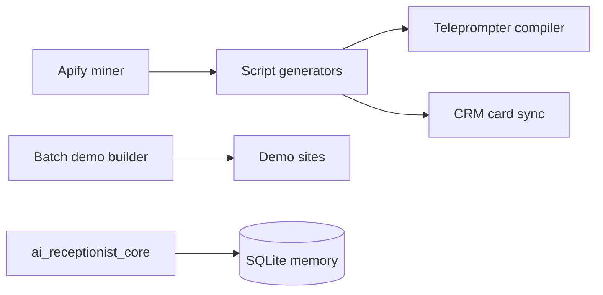

# Growth Studio

Scripts and small services for a content and lead-generation experiment: a daily content engine, a batch builder for demo websites from scraped Google Maps data, and a TypeScript chat-agent core.

**Why:** to test whether generated content and demo sites can feed a small agency pipeline. This is an experiment, not a product.

## Key features
- **Content engine** ([02_MOTOR_DE_CONTENIDO](02_MOTOR_DE_CONTENIDO/README.md)): viral and consulting script generators, a teleprompter compiler, a Telegram listener and video bot, transcription, and a CRM card sync.
- **Lead demo builder** ([01_GENERADOR_LOTES_LA](01_GENERADOR_LOTES_LA/README.md)): Apify Google Maps scraping, demo website generation for local businesses, and printable QR cards.
- **Chat-agent core** ([ai_receptionist_core](ai_receptionist_core/README.md)): message aggregation, media routing, natural-language formatting and per-user memory on SQLite, with Vitest tests.

## Architecture


## Stack
Python, Node.js and TypeScript, SQLite, Vitest and pytest, Apify, Telegram, Twenty CRM API.

## Structure
| Path | What it is |
|---|---|
| [01_GENERADOR_LOTES_LA/](01_GENERADOR_LOTES_LA/README.md) | Demo and batch builders |
| [02_MOTOR_DE_CONTENIDO/](02_MOTOR_DE_CONTENIDO/README.md) | Content engine and scripts |
| [ai_receptionist_core/](ai_receptionist_core/README.md) | Chat-agent core package |

## Run
Everything is configured through environment variables; none are included. Read each script before running it: several publish or sync with real services when keys are set.
```bash
cd ai_receptionist_core && npm install && npm test
```

## Status
🟡 Experimental and partly historical. Generated demos, videos, lead ledgers and strategy documents were removed from this copy. The core's tests were not re-run in this pass.

---

Built by Monoga · [github.com/Monoga2025](https://github.com/Monoga2025)
