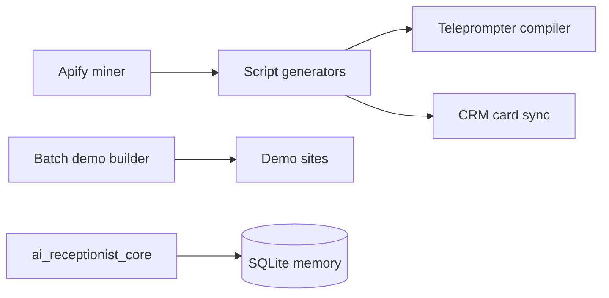

# Growth Studio

Content and lead-generation tooling for a small agency experiment: a daily content engine (viral/consulting script generators, teleprompter compiler and app, Telegram bot/listener, CRM card sync), a batch generator that builds demo sites for local businesses from scraped Maps data, and `ai_receptionist_core` - a TypeScript chat-agent core (message aggregation, media routing, per-user memory on SQLite).

**Stack:** Python, Node.js/TypeScript, SQLite, Vitest/pytest, Apify, Telegram, Twenty CRM API.

## Structure
`01_GENERADOR_LOTES_LA` demo/batch builders - `02_MOTOR_DE_CONTENIDO` content engine - `ai_receptionist_core` chat core with tests.

## Status (honest)
Experimental, historical. Scripts have side effects (publishing, syncing services) when run with real keys; read before executing. Generated demos, videos, lead ledgers, pricing and strategy docs were removed from this copy. Everything is configured by environment variables; none are included.

